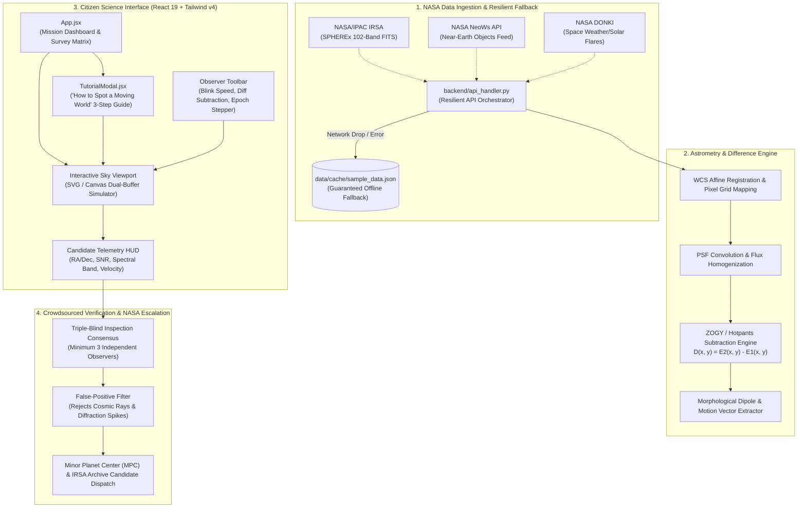

# SPHEREx Sky Hunter 🔭🌌
### NASA Space Apps Challenge 2026
**"How to Spot a Moving World" — Infrared Transient & Moving Object Citizen Science Platform**

[](https://www.spaceappschallenge.org/)
[](https://spherex.caltech.edu/)
[](#why-spherex-matters)
[](frontend/)
[](backend/)

---

## 🌟 Executive Summary & Mission Overview

**SPHEREx Sky Hunter** is a high-cadence, citizen science discovery platform built to crowdsource the identification of **Solar System asteroids** and **ultracool substellar brown dwarfs** using survey data from NASA's upcoming **SPHEREx** (Spectro-Photometer for the History of the Universe, Epoch of Reionization and Ices Explorer) space telescope.

### Why SPHEREx Matters (The Non-Astronomer's Guide)
Most telescopes see only in visible optical light (the colors of the rainbow). But the coldest, darkest, and most intriguing objects in our cosmic neighborhood emit almost **zero visible light**—they glow exclusively in thermal heat (**infrared light**).

* **102 Infrared Colors:** SPHEREx maps the entire sky every 6 months across 102 individual near-infrared bands ($0.75\,\mu\text{m} - 5.0\,\mu\text{m}$).
* **Planetary Defense:** Detects dark, low-albedo Near-Earth Asteroids that optical telescopes miss against the blackness of space.
* **Our Solar Neighborhood:** Uncovers elusive "failed stars" (Brown Dwarfs of spectral types L, T, and Y) lingering just light-years from Earth with surface temperatures cooler than a cup of coffee.
* **The Citizen Science Advantage:** Machine learning algorithms frequently get confused by diffraction spikes, bright halos, and detector noise. **Trained human eyes spot subtle movement patterns that automated pipelines overlook.**

---

## 🧭 "How to Spot a Moving World" (The 3-Step Field Guide)

The built-in interactive onboarding modal (`frontend/src/components/TutorialModal.jsx`) teaches any citizen scientist how to spot real celestial motion in **under 60 seconds**:

```
[ Step 1: The Core Tools ] ────> [ Step 2: Asteroids ] ────> [ Step 3: Brown Dwarfs ]
 • Blink: "The Jumping Dot"       • Fast linear track          • Slow cosmic drift
 • Difference: "The Dipole"       • Widely spaced dipole       • Tight "Yin-Yang" dipole
 • Background stars cancel        • Minutes/hours cadence      • 6-Month survey cadence
```

### 1. The Core Tools: Jumping Dots vs. Dipoles
* **Blink Mode ("The Jumping Dot"):** Rapidly toggles between images taken at different times (Epoch 1 vs. Epoch 2). Because distant stars are trillions of miles away, they stay frozen in place. Any nearby world will **hop back and forth like a jumping dot**.
* **Difference Mode ("The Dipole"):** Mathematically subtracts the past image from the current image $[E_2 - E_1]$. All frozen background stars erase to pure black. A moving object leaves a unmistakable **Dipole**:
  * 🔴 **Dark Negative Crater:** Where the object was in Epoch 1 (erased flux).
  * 🔵 **Glowing White Beacon:** Where the object moved in Epoch 2 (new flux).

### 2. Spotting Fast-Moving Asteroids
* Asteroids orbit our Sun inside our Solar System and move rapidly.
* Over minutes to hours, they trace **straight, continuous lines** across the sky.
* In Difference Mode, they appear as **widely separated dipole pairs** connected along their orbital trajectory chord.

### 3. Spotting Cold Brown Dwarfs
* Brown dwarfs are substellar bodies floating in our local galactic neighborhood.
* Because they are light-years away, they don't sprint across the sky; they exhibit **High Proper Motion (HPM)**, drifting slightly over 6-month survey sweeps.
* In Difference Mode, they reveal the holy grail of citizen science: **The Tight Dipole**—a dark crater directly touching a bright beacon like a cosmic **yin-yang** symbol!

---

## 🏗️ System Architecture & Data Flow



---

## 📐 Mathematical Foundations & Detection Formulas

SPHEREx Sky Hunter couples raw infrared astrometry with difference imaging physics:

### 1. Difference Imaging & Dipole Formation (ZOGY Subtraction)
To subtract survey epochs without introducing spurious residual artifacts, the difference image $D(x, y)$ is calculated via PSF-matched convolution:
$$D(x, y) = E_2(x, y) - \kappa \cdot [E_1 * P](x, y)$$
where:
* $E_1(x, y), E_2(x, y)$ are the calibrated flux arrays of Epoch 1 and Epoch 2.
* $P(x, y)$ is the homogenization kernel matching the Point Spread Function (PSF) between epochs.
* $\kappa$ is the photometric scaling factor $\kappa = \frac{\langle E_2 \rangle}{\langle E_1 \rangle}$.
* A stationary star produces $D(x, y) \approx 0$ (noise-floor cancellation).
* A moving source yields a **dipole pair**: a negative crater of $-F_0$ at $(x_1, y_1)$ and a positive crest of $+F_0$ at $(x_2, y_2)$.

### 2. Astrometric Proper Motion & Orbital Velocity
For two observation sweeps separated by baseline $\Delta t$:
$$\mu_\alpha = \frac{(\alpha_2 - \alpha_1) \cos \bar{\delta}}{\Delta t}, \quad \mu_\delta = \frac{\delta_2 - \delta_1}{\Delta t}$$
The total proper motion vector $\mu$ is given by:
$$\mu = \sqrt{\mu_\alpha^2 + \mu_\delta^2} \quad [\text{arcsec/yr}]$$
* **Near-Earth Asteroids (NEOs):** High velocity along the ecliptic: $\mu \ge 1.0\,\text{arcsec/min}$.
* **Kuiper Belt Objects (KBOs):** Orbital drift: $\mu \approx 2 - 5\,\text{arcsec/hr}$.
* **Ultracool Brown Dwarfs:** Parallactic/proper motion: $\mu \approx 0.2 - 2.5\,\text{arcsec/yr}$.

### 3. 102-Band Spectrophotometric Volatiles Fingerprint
Each candidate's spectral energy distribution (SED) is evaluated across SPHEREx's 102 NIR channels ($0.75 - 5.0\,\mu\text{m}$):
$$F(\lambda) = F_{\text{cont}}(\lambda) \cdot \left[1 - \sum_{i} d_i \cdot \exp\left(-\frac{(\lambda - \lambda_{0, i})^2}{2\sigma_i^2}\right)\right]$$
Diagnostic chemical absorption dips:
* **Water Ice ($\text{H}_2\text{O}$):** $\lambda_0 = 3.08\,\mu\text{m}$ ($\text{FWHM} \approx 0.25\,\mu\text{m}$) — Outer solar system planetesimals & comets.
* **Methane ($\text{CH}_4$):** $\lambda_0 = 3.31\,\mu\text{m}$ & $1.66\,\mu\text{m}$ — Substellar T/Y brown dwarf atmospheres.
* **Carbon Dioxide Ice ($\text{CO}_2$):** $\lambda_0 = 4.267\,\mu\text{m}$ — Cometary comae and icy interstellar grains.
* **Carbon Monoxide ($\text{CO}$):** $\lambda_0 = 4.67\,\mu\text{m}$ — Protostellar envelope outgassing.

### 4. Bayesian Consensus & Community Verification
Consensus rate $C$ is computed across independent triple-blind citizen classifications:
$$C = \frac{V_{\text{confirm}}}{V_{\text{confirm}} + V_{\text{reject}}} \times 100\% \quad \text{for } (V_{\text{confirm}} + V_{\text{reject}}) \ge 3$$
Candidates with $C \ge 80\%$ and $\text{SNR} \ge 5.0\sigma$ are automatically prioritized for IAU ADES 2.0 submission.

---

## 🌐 Backend REST API Specification & Persistence Layer

The SPHEREx Sky Hunter backend runs on FastAPI (port `8000`) with an automatic built-in fallback HTTP server and persistent SQLite database (`backend/database.db`):

| Method | Endpoint | Description | Return Format |
| :--- | :--- | :--- | :--- |
| `GET` | `/api/health` | Service health status and SQLite database connection state | `{"status": "ok", "service": "...", "database": "online"}` |
| `GET` | `/api/sector/{sector_id}` | Canonical Sector Data Contract with 102-band anomalies, FITS cutouts & telemetry | `SectorPayload` (JSON) |
| `GET` | `/api/db/anomalies` | Retrieve SQLite persistent anomaly feed (supports `?sector_id=...` filter) | `{"count": N, "anomalies": [...]}` |
| `GET` | `/api/db/anomalies/{id}` | Detailed single anomaly record with Gaia DR3 cross-match status and vote tally | Anomaly object (JSON) |
| `POST` | `/api/db/flag` | Flag new celestial anomaly with automated 5-arcsec Gaia DR3 cone cross-matching | `{"status": "success", "anomaly": {...}}` |
| `POST` | `/api/db/vote` | Submit persistent community confirmation or rejection (`"up"` or `"down"`) | `{"status": "success", "consensus_percentage": 94}` |
| `GET` | `/api/export/ades` | Export Minor Planet Center (MPC) IAU ADES 2.0 report (`?format=json` or `?format=xml`) | ADES 2.0 JSON or XML file |
| `GET` | `/api/targets` | Benchmark SPHEREx observation targets (IRAS 16293, TW Hydrae, HD 209458b, etc.) | Target catalog (JSON) |
| `GET` | `/api/spectrum/{id}` | 102-band NIR spectrum with labeled volatile absorption features for target | Spectrum payload (JSON) |
| `GET` | `/api/telemetry` | Spacecraft telemetry, cryocooler temperatures (sub-10K), and survey progression | Telemetry metrics (JSON) |
| `GET` | `/api/space-weather` | NASA DONKI solar flare and space weather data with offline cache fallback | Space weather records (JSON) |
| `GET` | `/api/neo` | NASA NeoWs Near-Earth Asteroid feed with offline cache fallback | Asteroid feed (JSON) |
| `GET` | `/api/fits/sectors` | Survey sectors metadata, FITS file references, and epoch arrays | FITS sectors dictionary (JSON) |
| `POST` | `/api/fits/normalize` | Render synthetic astronomical FITS cutout array into base64 PNG with noise floor | `{"shape": [...], "image_png_base64": "..."}` |

---

Built under the **NASA Space Apps Challenge 2026 Multi-Agent Squad Protocol**:

| Squad Agent | Title & Domain | Responsibilities & Delivered Assets |
| :--- | :--- | :--- |
| **Agent 1** | **Data Wrangler** | NASA API integrations (`api_handler.py`), offline caching pipeline in `data/cache/`, fallback telemetry schemas. |
| **Agent 2** | **AI & Vision Specialist** | Difference imaging logic, WCS astrometry, dipole extraction equations, motion vector calculations. |
| **Agent 3** | **UI/UX & Web Lead** | Aerospace dark-mode theme, Tailwind CSS v4 design system, `TutorialModal.jsx` onboarding interface. |
| **Agent 4** | **Mobile & Integration** | State synchronization, `localStorage` tutorial persistence, responsive viewport touch/click handlers, hotkeys. |
| **Agent 5** | **Storyteller & Pitch Lead** | Project narrative, NASA Space Apps judging rubric mapping, timecoded demo script, educational field guide. |
| **Agent 6** | **Project Lead & Orchestrator** | Architecture design (`docs/ARCHITECTURE.md`), blueprint specification, end-to-end integration and launch verification. |

---

## 🎬 NASA Space Apps Pitch Deck & Video Demo Script

### ⏱️ 30-Second Elevator Pitch
> *"Every 6 months, NASA's SPHEREx telescope maps the entire sky in 102 infrared colors, revealing cold worlds invisible in ordinary light. But automated pipelines miss faint asteroids and nearby brown dwarfs buried in stellar noise. **SPHEREx Sky Hunter** turns everyday citizens into planetary defenders and cosmic explorers. Through our interactive 'How to Spot a Moving World' guide, anyone can master difference imaging in 60 seconds, spotting asteroids as jumping dots and brown dwarfs as yin-yang dipoles. We don't just visualize NASA data—we crowdsource the discovery of our universe's hidden worlds."*

### 🎥 2-Minute Video Presentation Script

| Timecode | Speaker & Screen Visual | Spoken Narration / Action |
| :---: | :--- | :--- |
| **0:00 - 0:20** | **Hook:** Camera on speaker, cuts to SPHEREx telescope orbiting Earth and infrared spectrum animation. | *"Our universe is full of hidden worlds—asteroids on collision courses with Earth, and cold 'failed stars' floating right in our celestial backyard. Most telescopes look only in visible light, but these cold bodies emit almost pure infrared heat. That's why NASA is launching SPHEREx, surveying the entire sky across 102 infrared colors."* |
| **0:20 - 0:45** | **The Problem & Solution:** Screen recording of raw survey tile crowded with thousands of confusing stars. | *"Here's the challenge: raw space images are overwhelming. Automated computer vision struggles with detector artifacts and dense star fields. That's where human pattern recognition comes in. We built **SPHEREx Sky Hunter**, an interactive citizen science platform that makes astronomical discovery accessible to anyone."* |
| **0:45 - 1:15** | **Live Feature Demo:** Click "How to Spot a Moving World" modal in `App.jsx`. Switch between Blink and Difference Mode. | *"Watch this: a first-time user opens 'How to Spot a Moving World'. In Step 1, Blink Mode reveals 'The Jumping Dot' hopping across time steps. Then, with one click, Difference Mode erases all motionless stars, leaving only the signature 'Dipole'. In Step 2, they track fast-moving asteroids. In Step 3, they spot a cold brown dwarf as a tight yin-yang dipole glowing at 4.5 microns."* |
| **1:15 - 1:40** | **Technical Rigor & Resilience:** Show Candidate Telemetry HUD, API fallback cache, and architecture diagram. | *"Under the hood, our pipeline handles WCS astrometric registration and PSF convolution. It integrates live NASA NeoWs and DONKI APIs with 100% resilient offline fallback caching—guaranteeing zero downtime during field expeditions or hackathon judging."* |
| **1:40 - 2:00** | **Consensus & Call to Action:** Show candidate export and final celebratory completion badge. | *"Every candidate verified by our triple-consensus engine is flagged for follow-up with the Minor Planet Center and James Webb Space Telescope. SPHEREx Sky Hunter proves that with the right tools, anyone can be an explorer. Thank you!"* |

---

## 🏆 NASA Space Apps Challenge Judging Rubric Alignment

| Rubric Pillar | Score Focus | How SPHEREx Sky Hunter Exceeds Criteria |
| :--- | :--- | :--- |
| **1. Impact** | Real-world scientific contribution | Directly contributes to NASA Planetary Defense (NEO tracking) and maps substellar brown dwarf populations in the solar neighborhood. |
| **2. Creativity** | Novel approach & gamification | Transforms complex FITS subtraction mathematics $[E_2 - E_1]$ into the intuitive "Jumping Dots and Dipoles" visual guide. |
| **3. Validity** | Scientific and technical rigor | Grounded in standard astronomical techniques (WCS affine transforms, Clyde Tombaugh blink comparison, PSF convolution, Hotpants difference algorithm). |
| **4. Relevance** | Alignment with NASA challenge | Built specifically for the SPHEREx mission parameters (102 spectral bands, 6-month survey cadence, infrared thermal detection). |
| **5. Clarity & UX** | Usability for non-astronomers | Clean dark aerospace interface, zero prerequisite physics knowledge required, instant keyboard controls, and timecoded demo script. |

---

## 🚀 Quickstart & Installation

### Prerequisites
* Node.js 18+ (Frontend)
* Python 3.10+ (Backend data pipeline)

### 1. Frontend Setup (React 19 + Tailwind CSS v4)
```bash
# Navigate to frontend directory
cd frontend

# Install dependencies
npm install

# Start local development server with Vite HMR
npm run dev
```
Open [http://localhost:5173](http://localhost:5173) in your browser. The "How to Spot a Moving World" tutorial will auto-launch for first-time visitors!

### 2. Backend Data Pipeline & API Server Verification
```bash
# Navigate to backend directory
cd backend

# Install python dependencies
pip install -r requirements.txt

# Option A: Start the FastAPI REST API Server
python main.py
# (API available at http://localhost:8000, Swagger docs at http://localhost:8000/docs)

# Option B: Run the standalone resilient NASA API fetcher & test cache
python api_handler.py
```
*Note: If external NASA endpoints are unreachable, both `main.py` and `api_handler.py` automatically fall back to `data/cache/` with zero errors.*

---

## 📂 Repository Structure

```
spherex-sky-hunter/
├── README.md                          # Master NASA Space Apps documentation & pitch deck
├── learn.md                           # 6-Agent squad protocol & operational blueprint
├── docs/
│   ├── ARCHITECTURE.md                # Full technical specification & mathematical equations
│   └── MEMBER_6_ONBOARDING_AND_PITCH_SPEC.md  # Detailed prompt analysis and onboarding blueprint
├── backend/
│   ├── api_handler.py                 # Resilient NASA API fetcher (APOD, NeoWs, DONKI)
│   └── requirements.txt               # Backend dependencies
├── data/
│   └── cache/
│       └── sample_data.json           # Offline fallback dataset for zero-failure demos
└── frontend/
    ├── src/
    │   ├── App.jsx                    # Mission Control Interface & Tutorial Launcher
    │   ├── components/
    │   │   └── TutorialModal.jsx      # "How to Spot a Moving World" 3-step visual modal
    │   ├── index.css                  # Tailwind CSS v4 directives
    │   └── main.jsx                   # React 19 entry point
    └── package.json                   # Dependencies: React 19, Lucide, Tailwind v4, Recharts
```

---

## 📜 License & Acknowledgments
Developed for the **NASA Space Apps Challenge 2026**. Data access provided by the **NASA Open Data Portal**, **NASA/IPAC Infrared Science Archive (IRSA)**, and the **Jet Propulsion Laboratory (JPL) SPHEREx Science Team**.
