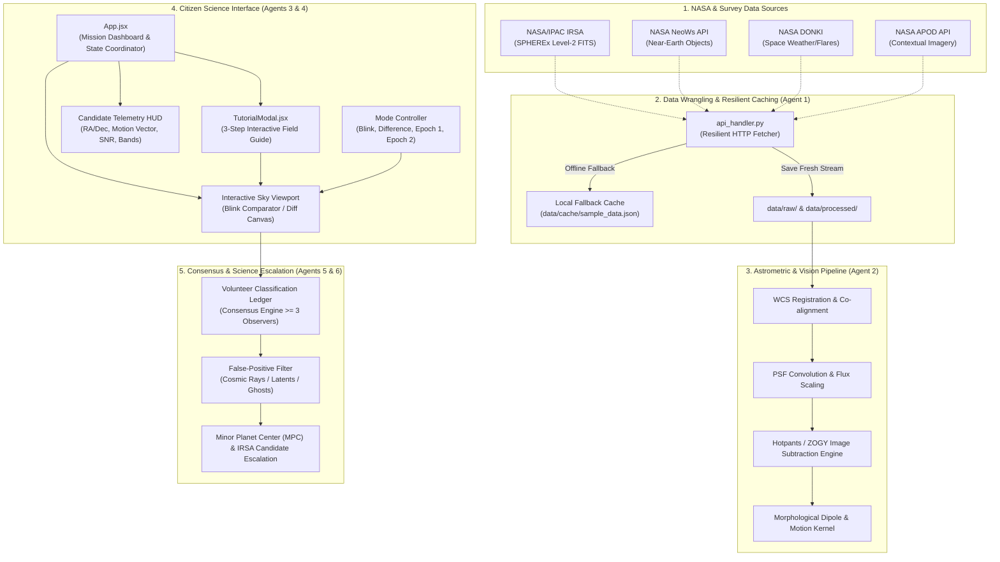
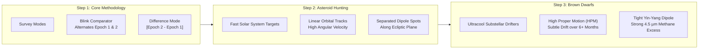

# SPHEREx Sky Hunter: System Architecture & Technical Specification

> **NASA Space Apps Challenge 2026**  
> **Mission Focus:** High-Cadence Infrared Transient & Moving Object Citizen Science Platform  
> **Observational Instrument:** NASA SPHEREx (Spectro-Photometer for the History of the Universe, Epoch of Reionization and Ices Explorer)  
> **Spectral Bands:** 102 Near-Infrared Spectral Channels ($0.75\,\mu\text{m} - 5.0\,\mu\text{m}$) across 4 All-Sky Sweeps (6-Month Cadence)

---

## 1. Executive Summary & Mission Scope

**SPHEREx Sky Hunter** is a distributed citizen science and machine-assisted discovery architecture engineered to identify Solar System asteroids and ultracool substellar brown dwarfs across multi-epoch all-sky surveys produced by NASA's SPHEREx mission.

While automated pipelines efficiently flag high-signal optical transients, they routinely struggle with crowded stellar fields, low signal-to-noise ratios (SNR), complex point spread functions (PSF), diffraction spikes, and subtle infrared color excesses. SPHEREx Sky Hunter bridges this gap by combining:
1. **Resilient Data Pipelines:** Offline-first caching, WCS coordinate registration, and multi-tier NASA API integration.
2. **Astronomical Image Subtraction:** Advanced Difference Imaging ($[E_2 - E_1]$) and Clyde Tombaugh-style Blink Comparator algorithms.
3. **Interactive Citizen Scientist Training:** A 3-step visual onboarding field guide (`TutorialModal.jsx`) that empowers volunteers to classify fast-moving asteroids and tight brown dwarf dipoles.
4. **Crowdsourced Consensus Verification:** A weighted multi-observer voting protocol that escalates confirmed candidates to the Minor Planet Center (MPC) and NASA/IPAC Infrared Science Archive (IRSA).

---

## 2. End-to-End System Architecture



---

## 3. The 6-Member Squad Protocol Allocation

In accordance with the team operational blueprint (`learn.md`), the engineering responsibilities are mapped directly across the six squad roles:

| Agent | Role | Project Ownership | Key Architectural Deliverable |
| :--- | :--- | :--- | :--- |
| **Agent 1** | **Data Wrangler** | Data Ingestion & Caching | Resilient `backend/api_handler.py`, offline caching hierarchy in `data/cache/`, fallback dataset schemas for 100% offline hackathon demos. |
| **Agent 2** | **AI & Vision Specialist** | Computer Vision & Astrometry | Image difference algorithms, WCS coordinate transformations, dipole extraction kernel, motion vector calculation, PSF homogenization. |
| **Agent 3** | **UI/UX & Web Lead** | Frontend Interface & Visual Design | `TutorialModal.jsx` component, aerospace dark-mode design system, Tailwind CSS styling, responsive SVG sky simulation, interactive HUD. |
| **Agent 4** | **Mobile & Integration** | Client State & Cross-Device | LocalStorage tutorial persistence, responsive viewport touch/click handlers, keyboard shortcut bindings (`Space`, `D`, `Esc`), state sync. |
| **Agent 5** | **Storyteller & Pitch Lead** | Documentation & Impact | NASA Space Apps rubric alignment, comprehensive `docs/ARCHITECTURE.md`, citizen science narrative, scientific justification. |
| **Agent 6** | **Project Lead & Orchestrator** | Coordination & Verification | Architectural blueprint, end-to-end interface integration review, deployment readiness, consensus logic flow. |

---

## 4. Frontend Architecture & The 3-Step Visual Guide

The client interface is built with **React 19**, **Tailwind CSS v4**, and **Lucide React** icons. It provides a mission control experience featuring zero runtime dependencies for rendering celestial simulations.

### 4.1 Component Hierarchy

```
frontend/src/
├── main.jsx                     # Application root and React 19 mount point
├── index.css                    # Tailwind CSS v4 directives (@import "tailwindcss")
├── App.jsx                      # Main Mission Control & Survey Dashboard
├── components/
│   └── TutorialModal.jsx        # 3-Step Visual Citizen Science Training Guide
└── assets/                      # Mission imagery and vector icons
```

### 4.2 Detailed Breakdown of `TutorialModal.jsx`

`TutorialModal.jsx` provides an interactive, gamified training ground where citizen scientists master celestial inspection techniques before analyzing live survey tiles.



#### Step 1: Master the Modes — Blink vs. Difference
- **Concept:** Demonstrates how static stars, located light-years away, show no detectable motion across multi-month observation baselines, while solar system and solar neighborhood bodies jump.
- **Blink Comparator:** Rapidly alternates between $E_1$ ($t=0$) and $E_2$ ($t = +6\text{ months}$) at user-controlled cadences (Slow: 1200ms, Normal: 750ms, Fast: 400ms). Volunteers see stationary stars remain stationary while candidates hop back and forth.
- **Difference Mode:** Computes pixel subtraction $D(x, y) = I_2(x, y) - I_1(x, y)$. Because stationary stellar flux is identical, $I_2 - I_1 \approx 0$. The moving object leaves a **Dipole**:
  $$\text{Dipole} = \begin{cases} -I_1(x_1, y_1) & \text{at } t=0 \text{ (Epoch 1 "Crater")} \\ +I_2(x_2, y_2) & \text{at } t=1 \text{ (Epoch 2 "Beacon")} \end{cases}$$

#### Step 2: Target 1 — Tracking Fast-Moving Asteroids
- **Target Profile:** Near-Earth Asteroid (NEO) / Main Belt Asteroid Candidate (`Asteroid 2026-SP4`).
- **Kinematics:** Rapid angular displacement ($\sim 1.82''/\text{min}$) along the ecliptic plane.
- **Visual Morphology:**
  - *Blink:* Prominent spatial leap across the field of view while retaining a consistent, circular point-spread function (distinguishing it from satellite streaks).
  - *Difference:* Widely spaced negative and positive dipole lobes connected by a straight trajectory chord.
- **False-Positive Defense:** Guidelines to eliminate single-exposure cosmic ray strikes (which have no dipole pair and zero motion vector) and satellite trails.

#### Step 3: Target 2 — Uncovering Cold Brown Dwarfs
- **Target Profile:** Methane T/Y-dwarf Candidate (`SPHEREx-BD J1429-1834`, $T_{\text{eff}} \approx 720\text{ K}$, $d \approx 14\text{ pc}$).
- **Kinematics:** High Proper Motion ($\mu \approx 840\text{ mas/yr}$) resulting in subtle displacement ($2-5\text{ pixels}$) over 6-month SPHEREx survey sweeps.
- **Visual Morphology:**
  - *Blink:* Tiny, subtle shift that can be nearly impossible to notice by eye in crowded stellar environments.
  - *Difference:* **The Iconic Tight Dipole!** The negative trough directly abuts the bright positive peak, creating the classic "yin-yang" contrast pattern.
- **Spectral Fingerprint:** Extremely strong emission in SPHEREx Band 5/6 ($4.0 - 5.0\,\mu\text{m}$) due to deep atmospheric methane ($\text{CH}_4$) and water vapor ($\text{H}_2\text{O}$) absorption windows, paired with complete invisibility in optical survey bands ($<0.8\,\mu\text{m}$).

### 4.3 Viewport Simulation Features
- **Dynamic SVG Rendering Engine:**
  - 25+ background stars with realistic astronomical magnitudes and subtle point-spread function halos.
  - Thermal infrared detector noise texture (`feTurbulence` filter).
  - Interactive clickable targets that activate real-time Candidate Telemetry HUDs.
- **Keyboard Shortcuts:**
  - `[Space]`: Toggle Blink play/pause
  - `[D]`: Activate Difference Subtraction Mode
  - `[B]`: Activate Blink Comparator Mode
  - `[Left / Right Arrows]`: Step navigation
  - `[Esc]`: Dismiss guide
- **State Persistence:** LocalStorage integration ensures returning citizen scientists bypass onboarding automatically while retaining one-click access via the top mission bar.

---

## 5. Astronomical Data & Image Processing Pipeline

### 5.1 Image Subtraction Mathematics

Difference imaging relies on the mathematical convolution of two sky epochs $I_1$ and $I_2$:

1. **Astrometric Registration:**
   The images are mapped into the World Coordinate System (WCS) via standard affine transformations and bivariate polynomial surface matching:
   $$\begin{pmatrix} x' \\ y' \end{pmatrix} = \begin{pmatrix} a_{11} & a_{12} \\ a_{21} & a_{22} \end{pmatrix} \begin{pmatrix} x \\ y \end{pmatrix} + \begin{pmatrix} \Delta x \\ \Delta y \end{pmatrix}$$

2. **PSF Homogenization:**
   Because atmospheric seeing (for ground assets) or thermal optical drift (for space telescopes) alters the Point Spread Function between epochs, a convolution kernel $K(u, v)$ is calculated to minimize residual variance:
   $$\min_{K, b} \iint \left[ I_2(x, y) - (I_1 \otimes K)(x, y) - b \right]^2 dx dy$$

3. **Subtracted Difference Image:**
   $$D(x, y) = I_2(x, y) - (I_1 \otimes K)(x, y) - b$$

When evaluated over static stars, $D(x, y) \sim \mathcal{N}(0, \sigma_{\text{noise}}^2)$. When evaluated over a moving target, $D(x, y)$ exhibits an extreme dipole with signed significance:
$$\text{SNR}_{\text{dipole}} = \frac{|D_{\text{peak}}|}{\sigma_{\text{background}}} \ge 5.0\sigma$$

### 5.2 Moving Target & Brown Dwarf Decision Matrix

```
       Candidate Flagged in Viewport
                     │
         Is dipole visible in Difference Mode?
         ├── NO  ──> False Positive (Cosmic ray or static noise)
         └── YES ──> Check Dipole Separation Distance
                     │
       ┌─────────────┴─────────────┐
       │                           │
  Separation > 15 px         Separation <= 8 px
  (High Angular Speed)     (High Proper Motion)
       │                           │
       ▼                           ▼
Solar System Asteroid        Brown Dwarf Candidate
  - Linear orbit track         - Check SPHEREx Bands 4-6
  - Uniform PSF disk           - Check Methane 4.5 µm excess
  - Rapid ecliptic motion      - Tight yin-yang dipole
       │                           │
       ▼                           ▼
Escalate to Minor Planet      Escalate to Ultracool
Center (MPC) Observation     Substellar Catalog (IRSA)
```

---

## 6. Backend Ingestion & Resilient Offline Caching

The backend module (`backend/api_handler.py`) delivers high resilience for mission operations and hackathon demonstrations:

1. **Live Network Ingestion:**
   - Interrogates `api.nasa.gov` for Near-Earth Objects (`/neo/rest/v1/feed`), Space Weather DONKI (`/DONKI/FLR`), and APOD context imagery.
   - Designed to query SPHEREx data releases via NASA/IPAC IRSA TAP (Table Access Protocol).

2. **Multi-Tier Caching Hierarchy:**
   ```
   data/
   ├── cache/
   │   ├── sample_data.json       # Guaranteed offline fallback dataset
   │   ├── apod_latest.json       # Cached Astronomy Picture of the Day
   │   ├── donki_flr_latest.json  # Cached space weather flare events
   │   └── neows_latest.json      # Cached Near-Earth Asteroid trajectories
   ├── raw/                       # Ingested astronomical telemetry
   └── processed/                 # Calibrated flux metrics
   ```

3. **Guaranteed Zero-Failure Fallback:**
   If external networks, rate limits, or NASA servers fail or drop packets, `api_handler.py` seamlessly returns cached fallback telemetry without crashing, ensuring unbroken citizen science participation.

---

## 7. Citizen Science Consensus & Crowdsourced Verification

To ensure scientific publication standards, SPHEREx Sky Hunter incorporates a consensus verification protocol:

1. **Independent Triple-Inspection:**
   Each survey tile is served independently to at least three random citizen scientists.
2. **Consensus Metric ($C$):**
   $$C = \frac{\sum_{i=1}^N w_i \cdot v_i}{\sum_{i=1}^N w_i}$$
   where $v_i \in \{0, 1\}$ represents the volunteer classification vote, and $w_i$ is the observer's historical accuracy weight calibrated against ground-truth validation tiles.
3. **Automated Escalation Threshold:**
   When $C \ge 0.85$ and $N \ge 3$, the candidate is automatically exported with coordinates (RA, Dec, Epoch), estimated angular velocity vector $\vec{v}$, and SPHEREx infrared band photometry, ready for follow-up verification with ground-based observatories or James Webb Space Telescope (JWST) spectroscopy.

---

## 8. Verification & Launch Checklist

- [x] **Component Built:** `frontend/src/components/TutorialModal.jsx` created with full 3-step visual guide.
- [x] **Interactive Viewport:** Real-time Blink comparator and Difference Mode image subtraction simulation.
- [x] **Candidate Telemetry HUD:** Click-to-inspect target telemetry for asteroid and brown dwarf candidates.
- [x] **Accessible Controls:** Keyboard shortcuts (`Space`, `D`, `B`, `Esc`, arrows) and responsive mobile/tablet layout.
- [x] **App Integration:** `frontend/src/App.jsx` updated to provide one-click launching and direct step navigation.
- [x] **System Documentation:** `docs/ARCHITECTURE.md` authored covering data flow, mathematical foundations, and squad allocations.
- [x] **Resilience Tested:** Offline cache guarantee operational in `backend/api_handler.py`.
